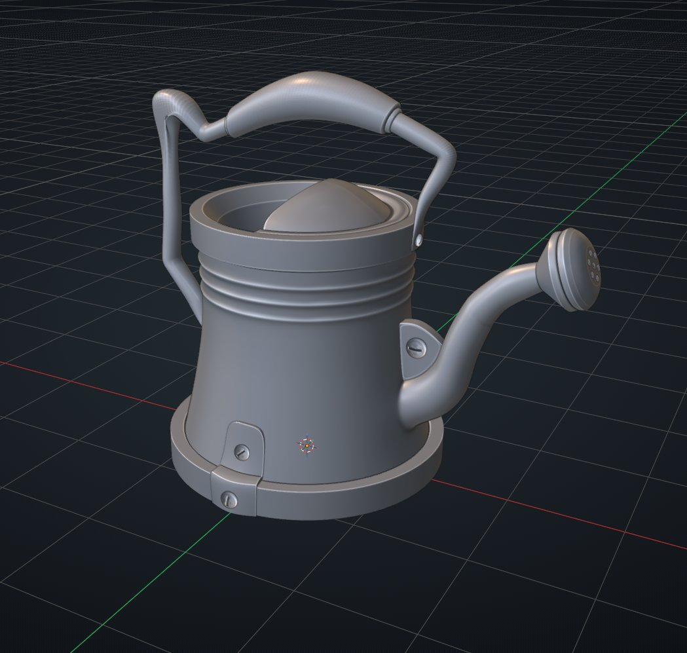

## 한 일
- [진행] 아트: Substance Painter 기초 강의 — Tutorial Full Workflow - Making a Stylized Watering Can | Blender & Painter (English) 2:51:00

## 메모
- 블렌더 모델링 완료
- High & Low collection 분리 완료
- Simple Renaming Addon 설치

## 다음에 할 것
- 아트: Substance Painter 기초 강의

## 오늘의 한 장

