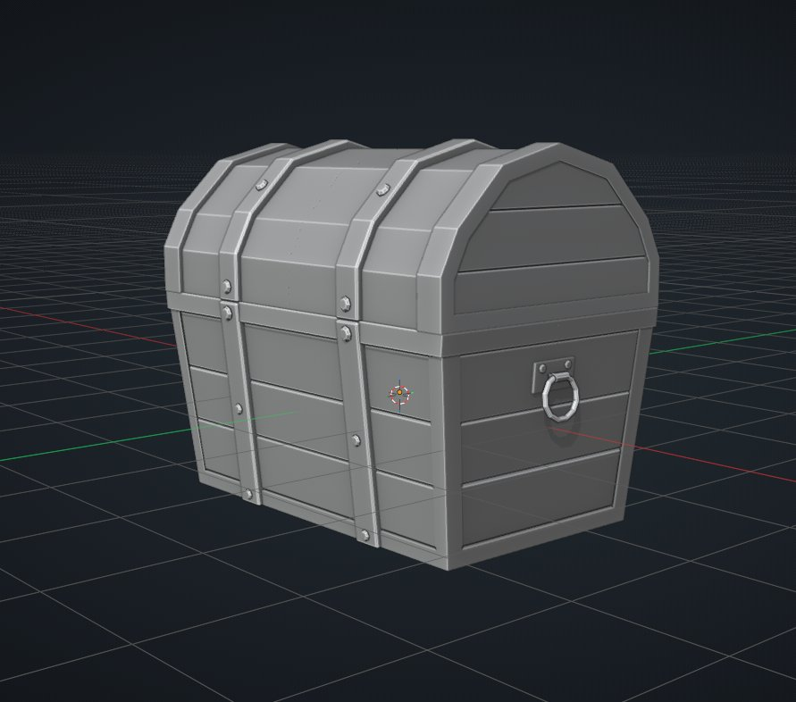

## 한 일
- [진행] 아트: Substance Painter 기초 강의 — Tutorial Full Workflow - Making a Stylized Watering Can | Blender & Painter (English) 2:51:00
- [진행] 아트: Blender modeling 강의  - Low Poly Treasure Chest - Part 1 (Blender Beginner Tutorial) — 45:26

## 메모
- 클로드 아티팩트에 영상 강의 목록을 만들어서 관리하기로 결정
- 로우폴리 모델링부터 빠르게 기능 위주 + 속도 증가 위주로 습득하고 스컬핑으로 이동 예정

## 다음에 할 것
- 아트: Substance Painter 기초 강의
- 아트: Blender modeling 강의  - Low Poly Treasure Chest - Part 1 (Blender Beginner Tutorial)

## 하루 요약
- 아트: Low Poly Treasure Chest Part 1을 시작했다(45:26까지).
- 아트 공부: 서브디비전, Shade Smooth와 Auto Smooth(4.1부터 Smooth by Angle 모디파이어), 스컬핑할 때의 셰이딩, Mark Seam을 Claude와 정리했다.
- 정함: 스컬핑으로 넘어가기 전에 로우폴리 모델링을 기능·속도 위주로 더 다진다.
- 강의 서가: study 폴더 강의와 새 모델링 후보를 썸네일 카드 129개로 모은 아티팩트를 만들었다(Agustin 채널 108개 확인 — Agustin 회원 전용·서브디비전·UV 묶음 추가).
- 컴퓨터: 블렌더 렉 원인을 찾았다. 장면(면 1,302개)과 하드웨어는 아니었고, Meta Quest Link의 가상 모니터를 의심해서 지웠다. 효과는 다음에 확인한다.

## 오늘의 한 장

